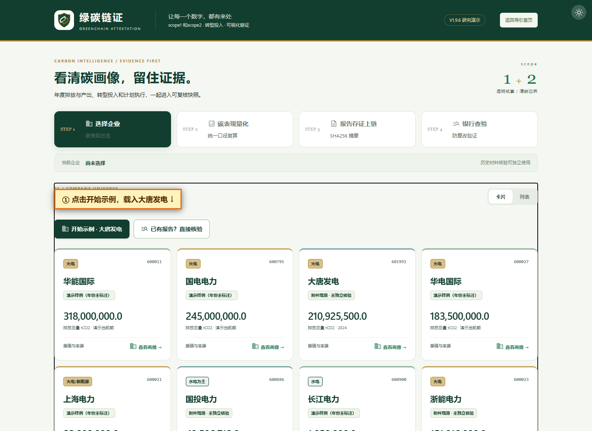
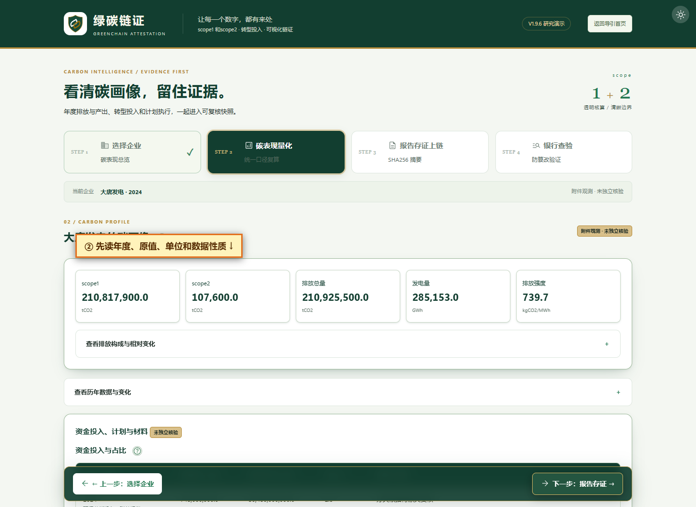
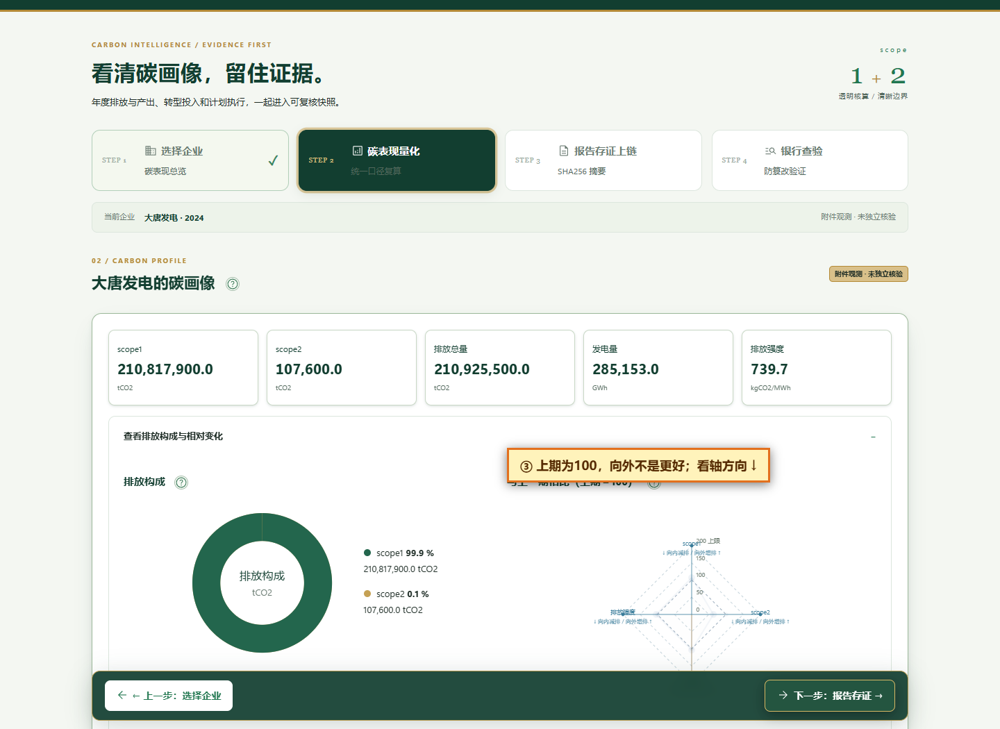
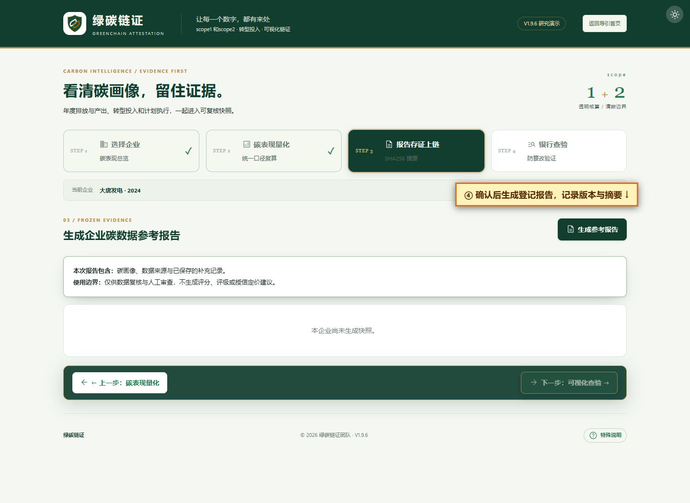
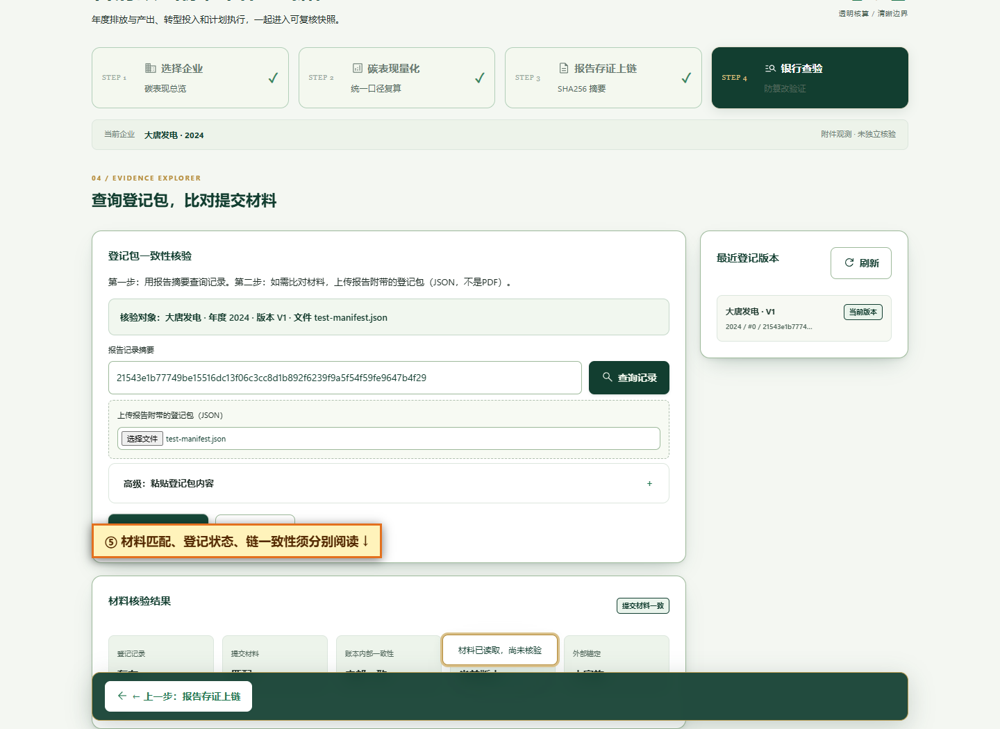

# 绿碳链证使用手册

2026年10月18日修订 · 对应桌面 `ICBC-CUP` 中的网页程序

这份手册按实际使用顺序写。第一次使用，先看第一至三章；遇到不认识的数字，查第四章；需要补资料、出报告或核对文件，再看后面的对应章节。截图上的橙色提示是为手册添加的，不是程序原有按钮。

## 一、先弄清这个程序能帮你做什么

打开程序，选一家企业，可以看到它的排放量、发电量和排放强度。你可以查看这些数字的来源线索，比较前后两期的变化，补上手头的材料，再把当前内容保存成一份报告。日后拿到一份登记包，还可以检查它与当时保存的内容是否相同。

这里有三个容易混淆的地方：

- **程序算出的数，不等于程序核实过的数。** 例如，强度的除法可以复算，但参与除法的披露数据仍需查原报告。
- **材料相同，不等于材料真实。** 一个错误数字也可以原样保存、原样核对。
- **报告已登记，不等于公共区块链已确认。** 当前记录保存在本机，没有其他机构独立保管，也没有外部锚定。

本版不再给综合分、A/B等级或利率建议。页面上的“碳表现量化”指展示原值和复算结果，不是信用评分。第四步虽然叫“银行查验”，实际做的是登记记录查询和材料比对，不能据此作贷款决定。

## 二、怎么启动，怎样确认没有打开旧版

### Windows

1. 打开项目文件夹。里面应能看到 `app.py`、`requirements.txt`、`server`、`data` 和 `启动.bat`。
2. 确保安装了Python 3.10或更新版本。打开终端输入 `py --version`，能显示版本号再继续。
3. 双击 `启动.bat`。首次运行通常要联网下载依赖，等窗口出现服务启动信息，不要提前关闭。
4. 浏览器访问 `http://127.0.0.1:8910/`。若这次交付已为你启动了8914预览，则访问 `http://127.0.0.1:8914/`。端口不同，只表示启动地址不同，不是版本号。
5. 使用期间保留终端。结束时在终端按Ctrl+C。

旧虚拟环境如果不能运行，脚本会把它改名为 `.venv-invalid-…`，保留原件，再创建新环境；正常环境不需要每次重建。不要把另一台电脑的 `.venv` 复制过来。

### macOS

先安装适合本机芯片的Python 3.10+。在终端输入 `cd `，把项目文件夹拖进去，回车后执行 `bash start.command`。默认地址也是8910；占用时执行 `PORT=8911 bash start.command`。不要双击Windows的bat或exe。详细排障见项目内的 `docs/MACOS_GUIDANCE.md`。

### 如果看到的仍是旧评分页

先按Ctrl+F5强制刷新。若仍出现大分数和B-，检查启动终端所在目录：本次使用的是桌面 `ICBC-CUP`，不要从旧压缩包或另一个同名文件夹启动。不要为了释放端口结束所有Python进程；可先换空闲端口。

## 三、第一次用，先完整走一遍

### 1. 进入工作台，选大唐发电

从首页进入企业工作台，点击“开始示例 · 大唐发电”。这比先填表更容易看懂。也可以点击企业卡片上的“查看画像”；“卡片/列表”只改变排列方式，不改变数据。

进入第二步后，先看上方当前企业，再看年度和“附件观测 · 未独立核验”标签。名字相同、年份不同，不能混作同一份材料。

### 2. 读五个原值

上面一排依次是scope1、scope2、排放总量、发电量、排放强度。先核对单位，详细解释见第四章。不要把五个数相加，也不要把其中任何一个当成百分制得分。

### 3. 展开图表

点击“查看排放构成与相对变化”。左边是scope1/2的构成，右边是前期为100的四轴变化图。再展开“查看历年数据与变化”，可以把图上的变化与年度原值对照。

### 4. 暂不补资料，先生成报告

点击底部“下一步：报告存证”，或上方第三步“报告存证上链”，再点“生成参考报告”。没有额外材料也能体验，缺项会继续显示“未取得”或“待补充”，不用填0凑齐。

滚动到报告底部，下载“原始登记包 JSON”。请把它和打印出来的报告放在一起。JSON留作核对，打印件便于阅读，二者不能互相替代。

### 5. 用下载文件核对一次

点击底部下一步进入第四步，摘要会自动带入。选择刚才下载的JSON，再点击“比较提交材料”。看到“材料已读取，尚未核验”时，还不算完成；必须等比较结果出现。

正常情况下，同一登记包会显示“提交材料一致”。下面还有登记、链内部一致性、版本和外部锚定几项，分别解释见第八章。

## 四、每个指标到底是什么意思

### 4.1 scope1：直接排放

scope1是企业所控制的设施和活动产生的直接排放。对电力企业来说，常见来源是燃料燃烧，但具体纳入哪些设施、气体与活动，必须以原报告为准。

页面单位是 **tCO2**，即吨二氧化碳。大唐2024附件数为210,817,900 tCO2，也就是21,081.79万吨。不要把“万吨”的数字直接填到以“吨”为单位的位置。

程序使用已有披露/附件值，**没有逐台机组读取燃料、热值、排放因子重新核算scope1**。核算方法页的“活动数据×排放因子”是方法解释，不表示程序已完成原始活动数据核算。

### 4.2 scope2：外购能源相关的间接排放

scope2主要指企业购买电力、热力等能源所对应的间接排放，不是把所有供应商的排放都算进来。范围3不是本页的一个隐藏得分项。

还要分清两种核算方法：地点法通常按用能所在地的电网等平均因子核算；市场法涉及符合条件的合同工具等信息。同一份外购能源用两种方法得到的数，不能相加算成两份排放。

大唐2024附件数为107,600 tCO2，即10.76万吨。当前附件没有确认scope2方法，所以程序把跨期复算标成演示假设，而不是已核实可比。

### 4.3 排放总量：这里仅指scope1加scope2

公式：**总量＝scope1＋scope2**。

大唐示例：210,817,900＋107,600＝**210,925,500 tCO2**。

这里不是企业完整生命周期排放，也不是碳市场履约量。两项必须属于可相加的年度、组织范围与气体口径；两项都填写了相应范围或气体元数据、且程序发现两者冲突时，不输出合计。元数据缺失不会自动拦住计算，所以仍需人工核对原报告。CO2与CO2e不能不说明就混用。

总量大，可能与业务规模有关；总量小，也可能只是企业规模小。不要直接据此认定哪家更先进或更值得贷款。

### 4.4 发电量：产出的规模

页面单位 **GWh**，1 GWh＝1,000 MWh＝100万kWh，也就是100万度电。大唐示例285,153 GWh，折合2,851.53亿度。

“发电量”与“装机容量”不同：前者是一段时间内实际发了多少电，后者是设备能力，常用MW或GW。不能拿装机容量填到发电量分母里；也不要把上网电量、售电量和发电量不加区分地互换。

### 4.5 排放强度：每单位发电量对应多少排放

公式：**排放强度＝（scope1＋scope2）÷发电量**。

本页用吨除以GWh，所得数值与kg/MWh相同，因为分子乘1,000变成kg、分母也乘1,000变成MWh，两项抵消。

大唐示例：210,925,500÷285,153≈**739.69 kgCO2/MWh**。也等于约0.73969 kgCO2/kWh。页面通常显示739.7，只是展示时四舍五入，不代表登记数据已被截成一位小数。

同口径下，强度较低表示每单位产出的排放较少，但差异还受水电/火电等业务结构影响，不能只看这个数就认定管理更优秀。分母缺失、为0或不能使用时，强度显示缺失，不按0处理。

### 4.6 同比：这次比上次变了多少

公式：**同比＝（本期÷前期－1）×100%**。例如100变为107，同比就是＋7%；100变为63，同比就是－37%。

同比需要前期大于0且两期数据可用。前期为0时不能用这个除法；缺数据也不能填成0%。还要核对组织范围、气体、scope2方法及期间是否一致。程序会利用已有元数据拦截部分已知冲突，但不会替你确认缺失信息，也没有自动检查两期是否为相邻年份；若隔了两年，不能把期间变化直接称为年度同比。

目前三家附件企业能演示跨期计算，但边界资料还不完整；另外五家未标明年份的演示企业，不会被补造出一条同比曲线。“算得出”与“已确认适合比较”是两回事。

强度下降也不能自动解释为企业主动改造：发电结构、业务调整、统计口径等都可能影响结果。总量上升、强度下降可以同时发生，因为发电量可能增长得更快。

### 4.7 清洁能源比例、环保投入比例：不要读错分母

附件中的清洁能源比例是**装机占比**，不是清洁发电量占比。这一信息在当前数据中作为补充背景保留，不能把它说成四轴图的一根轴，也不能把装机比例改名为发电结构。

资金投入表中的占比：**投入金额÷同年度总资本开支×100%**。大唐附件：7.48亿元÷304.8亿元×100%≈**2.45%**；表格按一位小数显示约2.5%。

环保节能投入不一定都属于低碳转型资本支出。分类要按材料原意写，并注明依据；没有可靠依据时，不要选一个听起来更“绿色”的分类。这个比例也不是投入回报率或碳减排率。

### 4.8 银行区的三个简单计算

- **现金流/年度债务服务**：输入经营现金流÷输入年度债务服务。比如1,200万元÷1,000万元＝1.2。它不是已审计的正式DSCR；分母缺失或无有效正值时不要作覆盖判断。
- **已还金额与贷款金额**：程序比较两者大小，只会描述所填记录是否达到贷款金额。没有核对银行流水、计划还款表，也不据此认定逾期或违约。
- **合同目标与实际观测**：先写清指标、单位、考核期间及方向。若目标是“强度不高于700”，实际680，数值上达到；实际720，没有达到。若是“清洁装机占比不低于40%”，应选相反方向。

这些都基于用户输入。显示“基础字段已填写，待人工核查”，不等于“贷款审核通过”。

## 五、几张图分别怎样读

### 排放构成图

这是scope1/2在两者合计中的比例。大唐示例scope2约占0.051%，图上很细是正常现象。看不清时读文字和原值，不要因为占比小就认为数据可以随便改。只有两项都有有效非负值且合计大于0时才画图。

### 第二步四轴变化图

四轴是scope1、scope2、发电量、强度。每一轴都把自己的前期数设为100，**不是四个轴用了同一个原始单位**。图上107相当于同比约＋7%，63相当于约－37%。

排放类轴向内是减少方向，向外是增加方向；发电量向外只表示产出增加。图的面积没有综合经济意义，不存在“越饱满越优秀”。同样的107可能对应完全不同的绝对排放量，所以不能拿它比较企业规模。

图只画到200。若真实指数超过200，会把点画在边缘并标实际值；不是把原始数字改成200。缺可比项时不补0、不硬闭合成完整多边形。

### 年度变化条形图与年度原值表

想知道具体变了多少，优先读同比数字和原值表，图只帮助找增减方向。先读数字前的正负号判断增减。发电量柱固定为金色；其他排放类指标增加时用褐色、减少时用绿色。发电量增加和排放增加含义不同，颜色不是好坏结论。点击、悬停或键盘聚焦可查看图点提示，手机操作以实际浏览器支持为准。

### 第三步三轴报告图

报告只保留scope1、scope2、发电量，避免把scope1/2之和、以及由总量/发电量算出的强度又作为独立轴重复展示。总量和强度并没有删，在上方原值表里。

要比较三家企业强度，请看原值：大唐约739.69、浙能约872.75、国投约287.71 kgCO2/MWh；不要用相对图面积替代这三个数字，也不要忽略业务结构与核算边界。

## 六、补充资料怎么填，怎样才算保存

补充入口在第二步下方“数据复核 / 补充”。它记录材料、投入、计划和银行信息，**不是直接修改上方排放原值的入口**。选错企业时先切回正确企业，别在当前表里用备注解释。

### 6.1 通用顺序

1. 展开“数据复核 / 补充”。
2. 填“本次补充 / 修订原因”。写具体变化，例如“补充2024年节能项目的报告页码”，别只写“更新”。页面最多接收1,000字。
3. 勾选需要填写的分区。未勾选的分区保持原样，不是清空。
4. 填好后点“预览本次补充”。这时只是显示检查结果，尚未写入数据库。
5. 核对预览，点“保存补充记录”。看到已保存提示和修订号增加，才算保存。
6. 若要交付报告，再到第三步重新生成。保存补充不会修改以前那份报告。

没填的可选数字留空。不知道金额填0，会让程序把它当作“确定是0”，不是“未知”。货币字段CNY以人民币元填写：748万元应填7,480,000，而不是748。

### 6.2 新增补充材料

| 页面字段 | 怎么填 | 必须吗 |
|---|---|---|
| 材料标题 | 能找到原件的标题，不只写“报告” | 必填 |
| 来源网址 | 完整http/https地址，不含登录密码 | 必填 |
| 年度 | 材料对应的年度，网页按1990—2100校验 | 必填 |
| 页码/定位 | 如“PDF第42页，环境绩效表” | 可空，但建议补 |
| 备注 | 说明它支持什么数据、哪些还没核对 | 可空 |

网址能提交不代表程序已读过链接内容；本页保存的是标题、网址和定位，不是自动上传/存储原PDF。

### 6.3 新增资金投入

年度、投入金额、投入分类、分类依据、来源报告标题、来源网址都要填。总资本支出可空；填写后必须大于0，而且不能小于本条投入金额，否则保存失败。这项金额关系由后端保存时检查，预览通过并不保证能保存。没有分母时不计算占比。

例如要记录一笔500万元节能改造投入，金额填5,000,000。若总资本开支2亿元，分母填200,000,000，占比为2.5%。先核对同年度、范围与币种，再算比例。

“环保节能投入”与“低碳转型资本支出”二选一时，按原材料证据选；分类依据应说明纳入的项目和判定理由。普通环保费用不能自动变成资本支出。

### 6.4 新增项目/转型计划

| 内容 | 填写要点 |
|---|---|
| 年度、项目名称 | 必填，名称应能与来源相互对应 |
| 技术 | 从风电、光伏、水电、储能、节能改造、其他中选 |
| 目标、实际 | 可以留空；有数就填非负数，不能混用单位 |
| 单位 | MW为容量、GWh为电量、site为项目/站点数、%为比例 |
| 执行记录 | 计划中、执行中、记录已完成，按材料填 |
| 来源报告标题、网址 | 必填；不要把项目名称当成来源报告标题 |
| 页码/定位 | 可空，建议补 |

百分比项须在0—100之间。目标100 MW、实际80 MW，可解释为数量完成80%；但当前页面主要列原值和状态，不保证处处显示完成率。选择“记录已完成”不会让系统核实工程是否已验收。

### 6.5 补充/更新银行记录

这组数字不是必须一次填齐，但勾选该区后，应补来源标题、网址，以及指标名称、单位、考核期间；普通表单保存时会要求这三项非空，预览却可能先通过。因此预览成功后，仍要确认保存是否成功。贷款金额、年度债务服务、已还金额不能填负数；经营现金流、合同目标和观测值允许负数，但必须符合所填指标的含义。

贷款金额、年度债务服务与经营现金流可以暂空，只是会继续显示材料待补。到期日按日期控件选择。目标方向“不高于”对应上限约束，“不低于”对应下限约束。先核对具体合同，不要默认选项就是合同要求。

### 6.6 导入JSON、编辑旧条目和修订冲突

普通表单适合新增条目。需要修改或删除旧条目时，展开“高级分区JSON输入”，点“载入现有分区供编辑/删除”。高级JSON优先于普通表单，提交哪个分区就用完整内容替换哪个分区；材料、投入、计划的空数组意味着清空该分区；`bank:{}`表示清空银行区。普通银行表单里把已有数字或日期擦空，可能仍保留旧值，不能当作删除操作。**不熟悉JSON时不要用这一功能批量删除。**

“导入补充JSON”最大5MB，只读取并预览，不自动保存。它与第四步的“报告登记包JSON”用途不同，不能互换。补充文件只接受materials、investments、plans、bank等规定分区，不能拿它覆盖排放快照。

如果提示“修订冲突”，说明你打开表单后，同一企业又有了新保存。点击“读取最新修订供手动合并（保留输入）”，对照服务器内容合并，再预览保存。这个按钮不会替你自动合并，也不会清掉你现有输入。文件中的旧修订号不应覆盖当前已读修订。

## 七、报告怎样保存，几个版本号怎样区分

第三步“生成参考报告”保存的是当时的画像、来源、已保存补充及必要说明。未保存的表单不会自动进入报告；如果出现未保存提醒，取消后先返回保存，或明确接受只生成旧的已保存内容。

- **首次生成**：建立报告V1。
- **重复生成相同内容**：可能提示“已复用现有登记包”，不会为了点击一次就制造一个新版本。
- **补充或画像内容变化后生成**：追加版本，关联上一份摘要；旧报告仍保留。
- **补充修订号**：每次保存补充增加一次，不等于报告版本。
- **应用版本**：如1.9.6，指程序发行身份，也不是报告V1/V2。
- **区块序号**：本机账本中的位置，从#0开始，不是企业评级或报告数量证明。

报告下方可打印或下载“原始登记包JSON”。浏览器打印对话框可选保存PDF；本程序的材料核验针对JSON登记内容，不是PDF像素或字节。要给别人核对，除了文件，还需让对方能取得对应登记记录，光发一张截图或一个摘要不够。

“记录摘要”和“区块哈希”也不同：前者标识登记内容，后者还涉及账本关联。第四步“报告记录摘要”填前者，不能随便从长字符串里选一个。

## 八、核验要做两次动作，别只查到记录就结束

### 8.1 只查询记录

可以从第一步点击“已有报告？直接核验”，不必重新选企业、生成新报告。在第四步粘贴完整摘要，点“查询记录”。摘要应是64位小写十六进制字符，别漏头尾，也别把区块哈希当摘要。

查到记录说明本机账本里有它。没有提交文件时，“提交材料”应理解为尚未比较，不应对外说“我的文件已验证”。

### 8.2 比较自己手里的文件

选“上传报告附带的登记包（JSON）”。文件不大于5MB，上传后会出现“材料已读取，尚未核验”；再点“比较提交材料”。也可在高级输入里完整粘贴JSON，不能只粘摘要。

程序比较解析后的登记内容，不是按文件名判断；单纯重命名文件不会让内容变假，JSON空格排版变化也不等于字段内容变更。修改字段值、删字段或拿错版本可能不匹配。普通PDF、截图、补充表单JSON不是对应的登记包。

### 8.3 逐项解释结果

| 结果 | 可以怎样表述 | 不要怎样表述 |
|---|---|---|
| 登记存在 | 本机找到这个摘要对应的记录 | 企业已通过认证 |
| 提交材料匹配 | 这份JSON登记内容与对应保存版本相同 | 原报告数字全部真实 |
| 提交材料不匹配 | 文件与选中登记版本有差异，需核对文件/版本 | 已证明企业造假 |
| 链内部一致 | 当前本地记录能通过内部关联检查 | 任何人都绝对无法重写 |
| 已被新版本替代 | 这是历史报告，另有更新版本 | 这份旧材料一定被篡改 |
| 外部锚定未实施 | 当前没有独立外部锚定证据 | 已获得公共区块链确认 |

修改摘要、替换文件或改粘贴内容后，旧比较结果会清空，需要重做。点“清空材料”可移除当前输入材料，不能删除账本中已经登记的报告。

### 8.4 查不到或对不上，按这个顺序排查

1. 当前是否是保存报告的那台电脑、那个项目目录？GitHub源码不会同步你的私人账本。
2. 是否填了正确的完整记录摘要，而不是区块哈希？
3. 文件是否为该版本下载的原始登记包？不是新版本/补充导入文件？
4. JSON是否完整、有无手工删改？
5. 若提示内部链损坏，先备份并查原因，不要手工改摘要“修到通过”。

## 九、第四步下面的实验要不要做

日常查材料可以跳过。想说明机制时再使用。

“只改一项，看看结果怎样变”在内存副本上实验：scope1增加10%时，合计与强度按公式联动；年份推后一年只是改标签，不产生下一年观测；把scope2改为市场法但没有新排放值时，合计与强度会显示待新方法数据，不能凭换方法声称减排。点“查看影响”后才会得到本次结果；切换条件后要重新点击。它不保存，不写账本，也不自动生成报告。

“八家企业：按维度查看”把三家附件企业与五家未标年份演示企业分开。三家附件企业按所选维度显示组内数值顺序；五家演示企业只列值、显示“不排名”，并不另排一个榜。这里没有综合榜。不同来源、业务结构和年份未确认时，不要据此下绩效结论。

“改一处数字，还能对上原记录吗？”复制一份记录来展示修改后为什么不匹配。展开“想了解更多”还能试断开链接或整本重算。这项体验实际是在副本中添加一项内容，保留原摘要和链接，展示链内部检查异常；它不是把某项排放量真的改掉，也不是自动执行上面的JSON材料比较。操作前先看展示的企业和版本，实验目标不一定就是第二步所选企业。这些按钮不修改真实记录。整本重算仍能自洽，恰好说明本地链的限制，不是安全性更强的证据。

## 十、文件放在哪里，哪些东西要一起备份

| 内容 | 默认位置/取得方法 | 用途 |
|---|---|---|
| 源码、说明、公开输入 | 项目文件夹 | 在别的电脑重新运行程序 |
| 用户补充数据库 | `data/processed/profile_extensions.sqlite3` | 保存各企业补充内容和修订历史 |
| 当前操作账本 | `data/processed/chain_ledger.json` | 保存报告登记及前后关系 |
| 原始登记包JSON | 第三步下载 | 提交内容比对 |
| 打印PDF | 浏览器打印时另存 | 阅读、汇报，不是当前JSON核验对象 |

备份前先停服务。数据库和账本应按同一次备份一起复制，不要把新数据库配旧账本；保留原件，不拿根目录旧版账本覆盖。真实银行材料、数据库和私有账本不要上传到GitHub。

换电脑只下载源码，能看到样例，不会自动看到旧电脑的新报告。这不是下载失败，是操作数据没有随源码发布。

## 十一、可以直接讲给别人听的一段介绍

“这个程序先把企业排放和发电量放到一张页面上，告诉我们每个数的单位、出处和算法。以大唐为例，两类排放相加，再除以发电量，就得到页面里的强度。图表帮助看前后变化，但我们不按图的面积给企业打分。资料确认后，可以生成一份带版本和摘要的报告；下次拿到登记包，就能查它与当时保存的是否相同。这里核对的是材料有没有变化，不是替企业证明填报真实，也不是替银行决定贷不贷款。”

讲解时按“一个原值算例→一张变化图→生成报告→比较文件”的顺序，通常比依次念完所有模块更容易听懂。

## 十二、本手册没有替你验证的事情

本手册按当前代码、字段与已有Windows Edge操作记录整理。五张标注图来自真实页面；补充字段的必填规则同时核对了前端和后端，但未把真实银行材料录入系统。没有在实体Mac、Safari、全新Windows或真实打印机上完成逐项验收。当前来源仍有未独立核验部分，不能因为手册更详细就改变数据性质。
